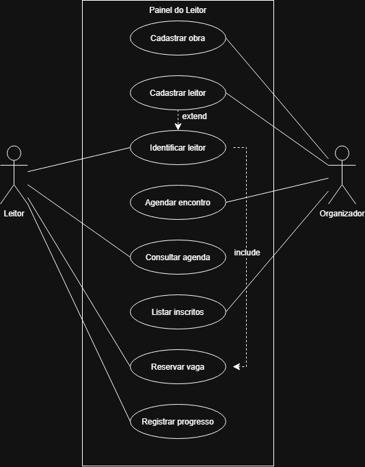

# 4.2.2 Modelagem de Casos de Uso

| Ator | Quem é | O que faz no sistema |
|---|---|---|
Leitor | estudante membro do clube do livro | consulta a agenda, reserva vaga, envia progresso e comentários |
| Organizador |	organizador responsável pelo clube do livro. Hoje, a Ana Schactae	| cadastra obras, agenda sessões e gerencia os participantes inscritos |

## Casos de uso

| Caso de uso | Ator | Atende |
|---|---|---|
| Cadastrar obra | Organizador	| RF01 |
| Cadastrar usuário | Organizador | RF02 |
| Identificar usuário | Leitor | RF03 |
| Agendar encontro | Organizador | RF04 |
| Consultar agenda | Leitor | RF05 |
| Listar inscritos | Organizador | RF06 |
| Reservar vaga | Leitor	| RF07 |
| Registrar progresso | Leitor	| RF08 |
## Diagrama de casos de uso

**Figura 1 – Diagrama de casos de uso do Painel do Leitor**

Fonte: Autoria própria (2026).

## Especificação do caso de uso principal

| Campo |  |
|---|---|
| Caso de uso |	Reservar vaga |
| Ator | Leitor |
| Pré-condição | O leitor possui conta no sistema (RF02), o encontro está agendado (RF01 e RF04) e a identificação do usuário foi realizada (RF03, «include»). |
| Pós-condição | A vaga do leitor fica confirmada na sessão escolhida e o número de vagas disponíveis é atualizado. |

**Fluxo principal**

1. O leitor identifica-se no sistema <<include>>.
2. O leitor consulta a agenda de encontros e seleciona a sessão.
3. O sistema exibe os detalhes do encontro e confirma as vagas abertas.
4. O leitor solicita a reserva da vaga na sessão.
5. O sistema valida se o leitor já tem reserva ativa para o mesmo encontro.
6. O sistema registra a inscrição do leitor e atualiza as vagas.
7. O sistema emite a confirmação da reserva na tela.

**Fluxo alternativo**

- **A1, no passo 2: o leitor já está inscrito na sessão.** O sistema informa que a vaga já foi garantida anteriormente e redireciona o leitor para a visualização da sua inscrição.

Fluxos de exceção

- **E1, no passo 2: a sessão está com lotação esgotada.** O sistema avisa que não há vagas disponíveis e o caso de uso termina sem a pós-condição. ❓ A confirmar com a cliente: quantas vagas estão disponíveis em cada reunião?
- **E2, no passo 4: o prazo de inscrição para a sessão já encerrou.** O sistema exibe mensagem de aviso informando o fim do período de reserva e o caso de uso é encerrado sem a pós-condição.

## Rastreabilidade com a 4.2.1

| Requisito | Caso de uso | Onde aparece |
|---|---|---|
| RF01 Cadastrar obra | Cadastrar obra | elipse, e pré-condição do sistema |
| RF02 Cadastrar usuário | Cadastrar usuário | elipse, e fluxo alternativo A1 (`«extend»`) |
| RF03 Identificar usuário | Identificar usuário | elipse, e passo 1 do fluxo principal (`«include»`) |
| RF04 Agendar encontro | Agendar encontro | elipse, e pré-condição de Reservar vaga |
| RF05 Consultar agenda | Consultar agenda | elipse, e passo 2 do fluxo de Reservar vaga |
| RF06 Listar inscritos | Listar inscritos | elipse |
| RF07 Reservar vaga | Reservar vaga | elipse e especificação principal |
| RF08 Registrar progresso | Registrar progresso | elipse |

**Todo requisito tem lugar.** Oito viraram elipse com o mesmo nome da coluna na 4.2.1.

**Toda elipse tem requisito.** Nenhum caso de uso foi inserido sem um requisito funcional na seção anterior.

**O que a especificação mudou.** O fluxo de reserva ajudou a definir como operar nas tentativas de inscrições duplicadas (fluxo alternativo A1) e lotação ou prazo encerrado (exceções E1 e E2).
