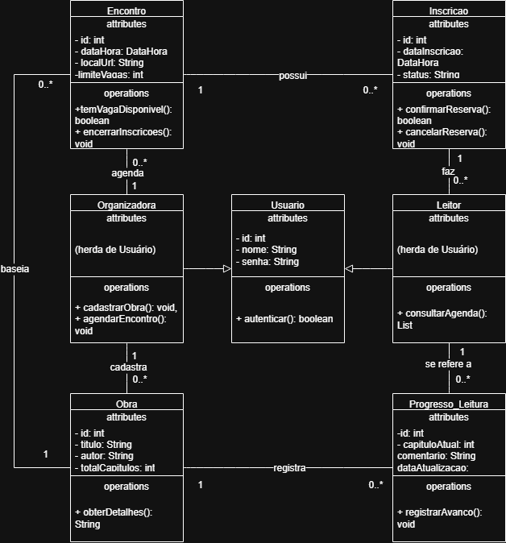

# 4.2.3 Modelagem de Classes

## Dos substantivos às classes

As classes saem dos substantivos identificados no escopo (4.1), nos requisitos (4.2.1) e na especificação do caso de uso principal **Reservar vaga** (4.2.2). Cada entidade informada pelo ator ou processada pelo sistema precisa de representação para persistência e manipulação dos dados.

Nem todo substantivo vira classe. Aplicam-se três filtros: o que é detalhe vira atributo; o que é elemento de interface gráfica ou controle não entra; e o que é elemento do mundo físico fora do software também fica de fora.

| Substantivo | De onde veio | Vira | Por quê |
|---|---|---|---|
| leitor, organizador | atores da 4.2.2, HU01 a HU05 | classes **Leitor** e **Organizador** | os dois atores que interagem com o sistema. Viram uma classe geral **Usuario** |
| usuário, login, senha | RF02, RF03, RNF02 | classe **Usuario** | a base para o login e dados pessoais dos membros e dos organizadores |
| obra | RF01, HU04, escopo da 4.1 | classe **Obra** | o livro cadastrado pela organizadora para ser lido no clube |
| encontro, sessão | RF04, RF07, escopo da 4.1 | classe **Encontro** | encontro para discutir uma obra em uma data específica |
| vaga, inscrição | RF06, RF07, fluxo de Reservar vaga | classe **Inscricao** | o registro que conecta o leitor ao encontro para garantir a participação |
| progresso, capítulo | RF08, HU03, escopo da 4.1 | classe **Progresso_Leitura** | o registro dos capítulos e das impressões registradas peloo leitor |
| WhatsApp, papel | falas da 4.2.1 | nada | ferramentas que o sistema substitui |

## Classes

Seis classes principais compõem o modelo do Painel do Leitor. Cada classe possui seus atributos no formato `nome: tipo` e métodos com parênteses, todos rastreados até os requisitos funcionais e fluxos operacionais.

| Classe | Atributos | Operações | Veio de |
|---|---|---|---|
| **Usuario** | - id: int, - nome: String, - email: String, - senha: String | + autenticar(): boolean | RF02 (Cadastrar usuário), RF03 (Identificar usuário) e RNF02 |
| **Leitor** | _herda de Usuario_ | + consultarAgenda(): List<Encontro> | RF05 (Consultar agenda) e perfil de acesso |
| **Organizadora** | _herda de Usuario_ | + cadastrarObra(): void, + agendarEncontro(): void | RF01 (Cadastrar obra) e RF04 (Agendar encontro) |
| **Obra** | - id: int, - titulo: String, - autor: String, - totalCapitulos: int | + obterDetalhes(): String | RF01 e base de dados para leitura dos encontros |
| **Encontro** | - id: int, - dataHora: DataHora, - localUrl: String, - limiteVagas: int | + temVagaDisponivel(): boolean, + encerrarInscricoes(): void | RF04, RF07 e passos 3 e 5 de Reservar vaga |
| **Inscricao** | - id: int, - dataInscricao: DataHora, - status: String | + confirmarReserva(): boolean, + cancelarReserva(): void | RF07 (Reservar vaga) e passo 6 da especificação |
| **Progresso_Leitura** | - id: int, - capituloAtual: int, - comentario: String, - dataAtualizacao: DataHora | + registrarAvanço(): void | RF08 (Registrar progresso) |

## Diagrama de classes

**Figura 2 – Diagrama de classes do Painel do Leitor**

Fonte: Autoria própria (2026).

A Figura 2 ilustra a estrutura de classes e seus relacionamentos:

- **Herança:** Representada pelo triângulo vazado apontando para a classe base `Usuario`. `Leitor` e `Mediador` configuram `Usuario`, herdando os atributos que o identificam e o método `autenticar()`.
- **Associações:**
  - Um `Mediador` cadastra zero ou várias (`0..*`) `Obra` e agenda zero ou vários (`0..*`) `Encontro`.
  - Uma `Obra` está associada a zero ou vários (`0..*`) `Encontro` (uma obra pode ser discutida em um ou mais encontros do clube).
  - Um `Leitor` realiza zero ou várias (`0..*`) `Inscricao`. Cada `Inscricao` pertence a exatamente um (`1`) `Leitor`.
  - Um `Encontro` possui zero ou várias (`0..*`) `Inscricao`. Cada `Inscricao` é direcionada a exatamente um (`1`) `Encontro`.
  - Um `Leitor` registra zero ou vários (`0..*`) `ProgressoLeitura`. Cada registro de `ProgressoLeitura` está vinculado a um (`1`) `Leitor` e a uma (`1`) `Obra`.

## Teste de objetos

Para validar as a estrutura do modelo, simulei a seguinte situação do clube: a mediadora Ana Schactae agendou um encontro para a obra *O Avesso da Pele*. A leitora Nath fez a reserva da sua vaga para a reunião e registrou seu avanço até o capítulo 1.

| Objeto | Classe | Valores |
|---|---|---|
| `ana` | Mediador | id = 1, nome = "Ana Schactae", email = "ana@ifpr.edu.br" |
| `nath` | Leitor | id = 2, nome = "Nath Ananias", email = "nath@alunos.ifpr.edu.br" |
| `O avesso da Pele` | Obra | id = 10, titulo = "O Avesso da Pele", autor = "Jeferson Tenório", totalCapitulos = 4 |
| `enc01` | Encontro | id = 101, dataHora = "25/12/2026 14:00", localUrl = "Sala 03 / Meet", limiteVagas = 20 |
| `insc01` | Inscricao | id = 501, dataInscricao = "10/04/2026 09:30", status = "Confirmada" |
| `prog01` | ProgressoLeitura | id = 901, capituloAtual = 1, comentario = "Páginas iniciais viciantes", dataAtualizacao = "12/04/2026" |

**Ligações:** `ana` e `oAvessodaPele`, `ana` e `enc01`, `oAvessodaPele` e `enc01`, `nath` e `insc01`, `enc01` e `insc01`, `nath` e `prog01`, `oAvessodaPele` e `prog01`.

**O que o teste confirma:**
- **Um leitor pode se inscrever em encontros diferentes e registrar os progressos de leitura.** O objeto `nath` é relacionado à sua inscrição e aos registros de leitura.
- **O encontro relaciona a obra e as inscrições recebidas.** O objeto `enc01` associa a obra `oAvessodaPele` à inscrição `insc01`.
- **A organizadora gerencia as obras e sessões.** O objeto `ana` aparece como criador da obra e do encontro.

## Rastreabilidade com a 4.2.2

| Operação ou atributo | Classe | De onde veio |
|---|---|---|
| autenticar() | Usuario | RF03 (Identificar usuário) e RNF02 |
| consultarAgenda() | Leitor | RF05 (Consultar agenda) e passo 2 de Reservar vaga |
| cadastrarObra() | Mediador | RF01 (Cadastrar obra) |
| agendarEncontro() | Mediador | RF04 (Agendar encontro) |
| temVagaDisponivel() | Encontro | passos 3 e 5 do fluxo principal de Reservar vaga e exceção E1 |
| confirmarReserva() | Inscricao | RF07 (Reservar vaga) e passo 6 do fluxo principal |
| registrarAvanço() | ProgressoLeitura | RF08 (Registrar progresso) |
| limiteVagas | Encontro | restrição do clube do passo 3 da reserva |

**Toda operação tem origem.** Todas as operações modeladas vem diretamente dos requisitos funcionais (RF01 a RF08) ou dos passos do caso de uso principal.

**Todo passo do sistema tem casa.** Os procedimentos da 4.2.2 tem métodos correspondentes nas classes responsáveis por processar as regras de negócio.

**O que a modelagem mudou.** Foi preciso separar `Obra` de `Encontro` (já que uma obra pode ser debatida em mais de uma sessão) e a classe `Inscricao` virou essencial para controlar o limite de vagas.
