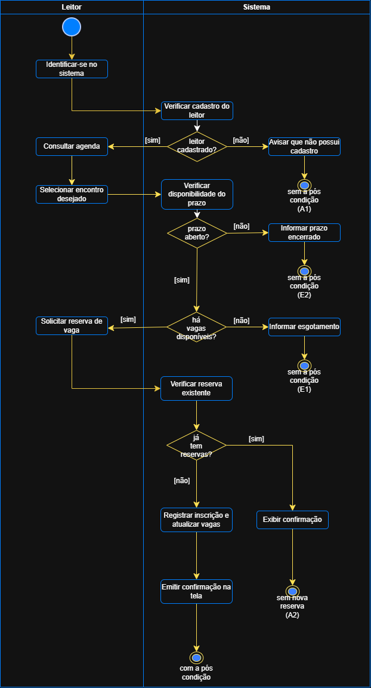

# 4.2.5 Modelagem de Atividade

## Do fluxo ao diagrama

O diagrama de atividades é o fluxo da 4.2.2 desenhado. A fonte é a especificação de **Reservar vaga**: o fluxo principal, os desvios alternativos (A1 e A2) e as exceções (E1 e E2). Nada entra no desenho que não esteja lá.

Três regras de tradução. Cada passo vira uma ação, na raia de quem faz. Cada "o sistema confirma" ou "o sistema verifica" vira uma ação seguida de uma decisão, porque confirmar é perguntar. E cada alternativo ou exceção vira uma saída da decisão que termina num fim próprio sinalizando o desfecho.

| No fluxo da 4.2.2 | Vira | Raia | Por quê |
|---|---|---|---|
| passo 1: o leitor identifica-se no sistema (RF03) | ação **Identificar-se no sistema**, ação **Verificar cadastro do leitor** e decisão _leitor cadastrado?_ | Leitor / Sistema | o ator inicia a identificação e o sistema valida se o cadastro foi feito pelo organizador |
| A1: o leitor não possui conta cadastrada | saída [não] da primeira decisão, ação **Avisar que não possui cadastro** e um **fim** (`sem a pós condição (A1)`) | Sistema | o leitor não realiza auto-cadastro; o fluxo encerra sem a pós-condição |
| passo 2: o leitor consulta a agenda (RF05) e seleciona o encontro | ações **Consultar agenda** e **Selecionar encontro desejado** | Leitor | ações executadas pelo ator na escolha da sessão |
| passo 3: o sistema exibe detalhes e confirma prazo e vagas | ação **Verificar disponibilidade do prazo** e **duas decisões**: _prazo aberto?_ e _há vagas disponíveis?_ | Sistema | um passo com duas conferências esconde duas perguntas. A E2 sai da primeira e a E1 sai da segunda |
| E2: o prazo de inscrição encerrou | saída [não] da decisão de prazo, ação **Informar prazo encerrado** e um **fim** próprio (`sem a pós condição (E2)`) | Sistema | exceção que encerra o caso sem a pós-condição |
| E1: o encontro está com lotação esgotada | saída [não] da decisão de vagas, ação **Informar esgotamento** e um **fim** próprio (`sem a pós condição (E1)`) | Sistema | exceção que encerra o caso sem a pós-condição |
| passo 4: o leitor solicita a reserva de sua vaga | ação **Solicitar reserva de vaga** | Leitor | ação de confirmação do ator |
| passo 5: o sistema valida se o leitor já possui reserva ativa | ação **Verificar reserva existente** e decisão _já tem reservas?_ | Sistema | confirmar ausência de duplicidade é perguntar. O A2 sai do [sim] |
| A2: o leitor já está inscrito na sessão | saída [sim], ação **Exibir confirmação** e um **fim** próprio (`sem nova reserva (A2)`) | Sistema | desvio alternativo que apenas informa a reserva já garantida anteriormente |
| passos 6 e 7: o sistema registra a inscrição, atualiza vagas e emite confirmação | ações **Registrar inscrição e atualizar vagas** e **Emitir confirmação na tela**, e o **fim** do caminho feliz (`com a pós condição`) | Sistema | os passos que entregam a pós-condição. É o único fim com ela |

## Diagrama de atividades

**Figura 4 – Diagrama de atividades de Reservar vaga**

Fonte: Autoria própria (2026).

A Figura 4 tem duas raias. A da esquerda é do **Leitor**, a da direita é do **Sistema**. Cada ação está na raia de quem a faz, e as setas cruzam de uma raia para a outra toda vez que a vez passa de um para o outro. Lendo de cima para baixo, o desenho representa a interação completa de reserva no clube do livro.

O círculo cheio no alto é o **início**. As quatro **decisões** são os losangos com pergunta, e cada uma tem duas saídas com a guarda entre colchetes: `[sim]` e `[não]`. Não há junção de retorno porque o cadastro de novos leitores (A1) é realizado externamente pelo organizador.

Há cinco **fins**. O de baixo, na base da raia do Sistema, é o único em que a pós-condição acontece: a inscrição registrada, as vagas atualizadas e a confirmação exibida na tela (`com a pós condição`). Os quatro alvos da direita são os fins de A1, E2, E1 e A2, e cada um diz o que ficou sem acontecer. Um caso de uso que pode terminar de cinco jeitos tem cinco fins. Juntar tudo num fim só esconderia isso.

Não há barra de sincronização (as duas barras grossas que separam e juntam caminhos paralelos). Nada em **Reservar vaga** acontece ao mesmo tempo: é uma sequência de passos, uma coisa depois da outra. O símbolo não entra para enfeitar.

## Rastreabilidade com a 4.2.2

| Elemento do diagrama | Vem de | Confere |
|---|---|---|
| Identificar-se no sistema, Consultar agenda, Selecionar encontro desejado, Solicitar reserva de vaga | passos 1, 2 e 4 (o leitor) | quatro ações na raia do ator |
| Verificar cadastro do leitor, Verificar disponibilidade do prazo, Verificar reserva existente, Registrar inscrição e atualizar vagas, Emitir confirmação na tela | passos 1, 3, 5, 6 e 7 (o sistema) | cinco ações principais na raia do sistema, alinhadas às operações `autenticar()`, `temVagaDisponivel()` e `confirmarReserva()` da 4.2.3 |
| leitor cadastrado? [não] | A1 (no passo 1) | termina em fim próprio sem a pós-condição (`sem a pós condição (A1)`) |
| prazo aberto? [não] | E2 (no passo 3) | termina em fim próprio sem a pós-condição (`sem a pós condição (E2)`) |
| há vagas disponíveis? [não] | E1 (no passo 3) | termina em fim próprio sem a pós-condição (`sem a pós condição (E1)`) |
| já tem reservas? [sim] | A2 (no passo 5) | termina em fim próprio informando a reserva prévia (`sem nova reserva (A2)`) |
| fim `com a pós condição` | pós-condição da 4.2.2 | só o caminho feliz chega nele |

**Todo passo tem elemento.** Os sete passos, o A1, o A2, a E1 e a E2 estão no desenho, e nenhum elemento do desenho veio de fora do escopo.

**Toda decisão tem as duas saídas.** Cada losango com pergunta tem um `[sim]` e um `[não]`, e cada saída leva a um lugar: o fluxo principal, o A1, o A2, a E1 ou a E2.

**O que o desenho mudou.** O passo 3 da 4.2.2 concentrava a conferência do prazo e das vagas num único passo. Desenhar mostrou que a E2 e a E1 saem de perguntas diferentes. A especificação continua certa, mas o passo 3 ganhou uma nota para a próxima revisão sobre dividir o desenho.
